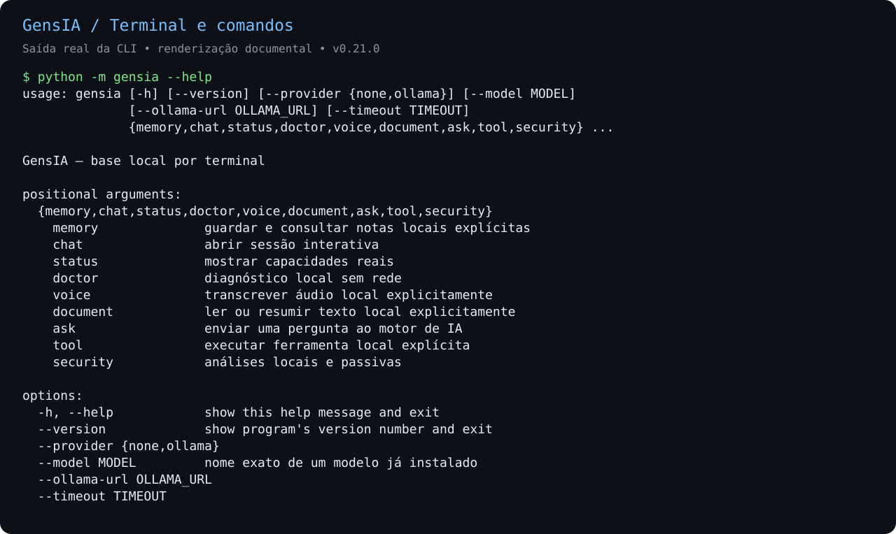
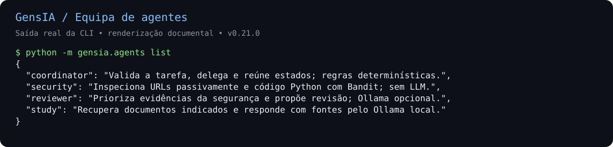
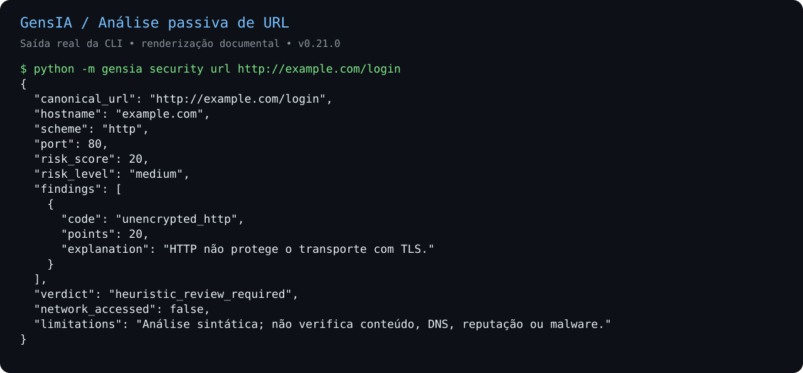
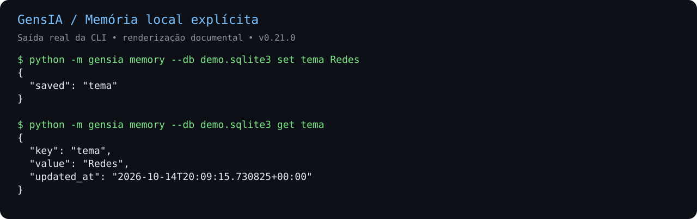
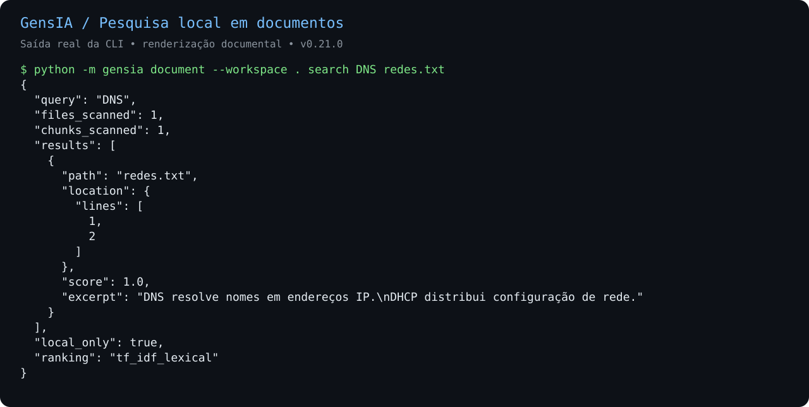

# GensIA

Assistente pessoal modular, com prioridade ao processamento local e controlo
explícito sobre ferramentas e dados. Versão atual: **0.29.0** — protótipo em evolução.

Novo: [extração PDF supervisionada](docs/PDF_PROCESS.md), com processo separado e
timeout explícito: `python -m gensia document --workspace . pdf-read exemplo.pdf --pdf-timeout 30`.
Leitura, resumo, perguntas, pesquisa PDF e tutor usam a supervisão por omissão.
Em Linux, o worker agora limita espaço de endereçamento (512 MiB), CPU (30s),
tamanho por ficheiro escrito (2 MiB) e core dumps (0); mantém tetos herdados menores.
Não é sandbox. Windows conserva timeout, sem estas quotas; ver o guia acima.

Novo: [backup explícito das notas locais](docs/MEMORY_BACKUP.md), em JSON versionado:
`python -m gensia memory backup --output notas.memory-backup.json`.
O ficheiro contém dados completos e não está encriptado. [Restauro validado](docs/MEMORY_RESTORE.md)
para base nova: `python -m gensia memory --db nova.sqlite3 restore --input notas.memory-backup.json --approve`.

Novo: [aplicações Windows com caminho absoluto](docs/WINDOWS_APPS.md), obtido das
APIs do sistema, sem procurar executáveis no PATH. Validação Windows real pendente.

Novo: [leitura limitada de TXT/Markdown/PDF](docs/DOCUMENT_LIMITS.md), incluindo
recusa se o conteúdo ultrapassar o limite entre a verificação e a leitura.

Correções de segurança: escrita de auditoria mais restrita e tratamento de erros
Ollama sem revelar corpos de erro. A [avaliação para uso pessoal e clientes](docs/PRODUCT_READINESS.md)
regista os bloqueios antes de um piloto comercial; a versão ainda não está aprovada
para venda geral ou alojamento partilhado entre clientes.

Novo: [exportação HTML autenticada pela API](docs/API_REPORT.md), em
`GET /agents/report`. É um anexo estático, não um painel interativo.

Novo: [pesquisa literal nas notas locais](docs/MEMORY_SEARCH.md), com paginação,
sem rede nem envio ao modelo: `python -m gensia memory search DNS`.

Novo: [relatório visual HTML offline dos agentes](docs/CATALOG_REPORT.md), sem
dependências adicionais. Exporta com `python -m gensia.catalog_report --output catalogo.html`
sem substituir ficheiros existentes. É uma consulta estática; o painel ligado à API continua planeado.

## Demonstração visual

O [teste de apresentação desktop/mobile](docs/VISUAL_VALIDATION.md) gera capturas
reais quando Chromium está disponível. A execução de 15/10/2026 ficou bloqueada
pela ausência do navegador; não há ainda screenshots HTML validados.

A interface disponível é **por terminal**, acompanhada de uma API local autenticada.
As imagens abaixo reproduzem saídas reais da CLI com dados fictícios de demonstração;
são renderizações documentais, não capturas de um painel gráfico. A GUI está planeada.











**Para recrutadores:** [visão geral, arquitetura, evidências e limitações](docs/SHOWCASE.md).
As [transcrições originais](docs/screenshots/) e o
[script de reprodução](scripts/capture_showcase.py) acompanham as imagens.

## Começar

Requer Python 3.10 ou superior. Na pasta do repositório:

```powershell
py -3 -m gensia --help
py -3 -m gensia --version
py -3 -m unittest discover -s tests -v
```

A base por terminal usa a biblioteca padrão. As integrações de voz, PDF e API são
opcionais e têm instruções próprias no [guia de utilização](docs/USAGE.md).
Não é necessário instalar todas as bibliotecas para começar.

## Capacidades implementadas

| Área | Estado |
| --- | --- |
| Texto e modelos | Terminal e integração local com Ollama |
| Sistema | Listagem confinada e abertura explícita de aplicações permitidas |
| Memória | SQLite com guardar, consultar e apagar explícitos |
| Voz | Adaptadores Whisper/Piper e gravação limitada de microfone |
| Documentos | TXT/Markdown/PDF, pesquisa lexical e respostas com referências |
| Cibersegurança | URLs passivas, VirusTotal opt-in, CISA KEV e adaptador Bandit |
| API | Estado, diagnóstico e catálogo dos agentes em loopback, com token |
| Agentes | Coordenador, segurança, revisor e tutor; tarefas locais explícitas |
| Apresentação visual | Relatório HTML offline; painel interativo ainda planeado |

As capacidades opcionais precisam dos respetivos motores/modelos. Implementação
de um adaptador não significa validação com hardware ou serviços reais.

## Equipa de agentes

```powershell
py -3 -m gensia.agents list
py -3 -m gensia.doctor --model qwen2.5:0.5b
py -3 -m gensia.agents audit --workspace . --url https://example.com
```

O coordenador delega tarefas delimitadas e o revisor recebe as evidências da
segurança. Para analisar Python é necessário Bandit; para estudo e revisão com
modelo, Ollama local. Ver [comandos e limites](docs/AGENT_TEAM.md).
Publicar o código no GitHub não inicia processos permanentes nem monitorização.
O [diagnóstico local](docs/DOCTOR.md) verifica pré-requisitos sem prompts, downloads
ou arranque de serviços. Um modelo listado ainda precisa de validação de inferência.
O endpoint autenticado `GET /agents` descreve as capacidades e os limites dos
agentes, mas não os executa. Ver [catálogo na API](docs/AGENT_CATALOG_API.md).

## Organização

- `gensia/`: módulos Python e interfaces CLI/API.
- `tests/`: testes automatizados.
- `docs/USAGE.md`: instalação opcional, comandos e exemplos.
- `docs/ARCHITECTURE.md`: arquitetura e limites de confiança.
- `PROGRESS.md`: histórico dos incrementos e próximo passo.
- `VALIDATION.txt`: evidências e limitações dos testes.
- `requirements-api.txt`: dependências opcionais da API.

## Validação

Na v0.29.0 os 241 testes Python passaram, com as dependências opcionais da API/PDF
e `GENSIA_TEST_REAL_HTTP=1`, sem omissões. Inclui quatro testes com Uvicorn real
em loopback, além dos testes em processo. Ver [reprodução](docs/API_REPORT.md).
Windows, hardware de áudio e vários motores externos ainda precisam de testes reais.
Nove testes novos cobrem quotas PDF, incluindo processos Linux reais com falhas
de alocação/escrita/CPU e extração de PDF bem-sucedida após falha de recursos.

Na v0.24.1, Bandit 1.9.4 real encontrou três avisos baixos B404, nenhum
achado médio/alto e nenhum erro de análise. Isto não garante ausência de vulnerabilidades. Ollama 0.40.4
real respondeu à API; inferência pendente porque a rede impediu o download do
modelo. Ver [relatório de integração](docs/REAL_ENGINE_VALIDATION.md).

## Privacidade e permissões

Não há fallback cloud automático. Consultas externas exigem autorização explícita.
Não envia emails. O modelo não recebe autorização para executar comandos livres.
A API não expõe memória, documentos nem operações mutáveis. Os adaptadores não
constituem uma sandbox de sistema operativo para código hostil.

Nunca versionar tokens, `.env`, gravações, documentos pessoais, bases SQLite,
pesos de modelos ou ambientes virtuais. Não foi atribuída uma licença de
distribuição ao projeto; as dependências mantêm as suas próprias licenças.

## Continuidade

Próximo incremento: reforçar a abertura de documentos contra troca concorrente de
caminhos/ficheiros, sem alegar isolamento Windows ainda não validado. Permanecem
pendentes inferência Ollama real e painel local de leitura, sem CDN e com token.
Consultar [PROGRESS.md](PROGRESS.md) antes de iniciar alterações.
