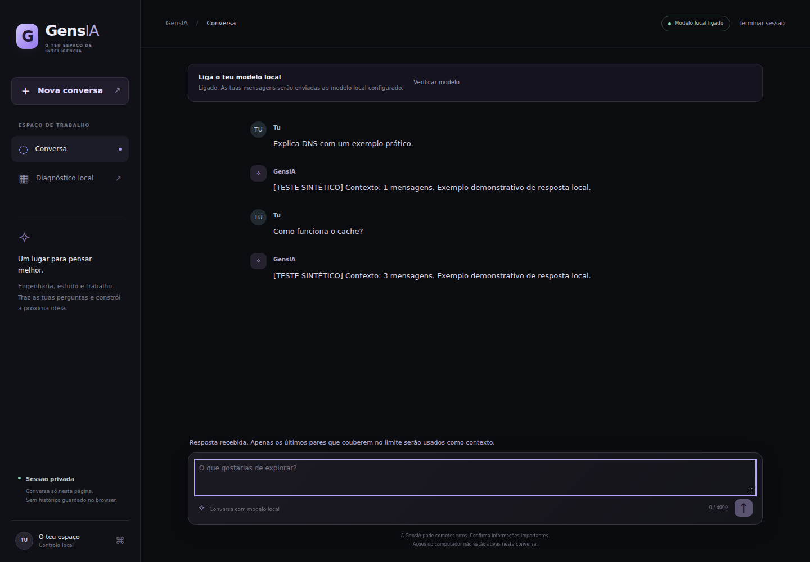

# GensIA



Captura real do job Chromium em 21/10/2026; dados e respostas são sintéticos.
[Evidência e origem das capturas](docs/screenshots/ci-39520092421/README.md).

Assistente pessoal modular para conversar com um modelo local, consultar documentos,
guardar notas e executar operações explícitas no computador. Python, SQLite e
FastAPI; interface web servida pelo próprio computador, sem CDN.

**Candidata 0.62.0 — RELEASE BLOCKED.** Esta branch recupera uma conversa funcional
e corrige falhas de autorização, privacidade e integridade reproduzidas na base
remota 0.34. A avaliação está em [RELEASE_CHECKLIST](docs/RELEASE_CHECKLIST.md) e
[TEST_REPORT](docs/TEST_REPORT.md). Serviços sintéticos não comprovam pesos reais.

## Instalar e abrir

Python 3.12/3.13 são as configurações previstas no CI. O núcleo declara >=3.10;
essa versão mínima precisa de validação própria. Ollama e um modelo local confiável
devem estar previamente instalados para conversar.

PowerShell, na pasta do repositório:

```powershell
py -3 -m venv .venv
.\.venv\Scripts\python.exe -m pip install -e ".[api,documents]"
.\.venv\Scripts\python.exe -m pip check
.\.venv\Scripts\python.exe -m gensia.api --chat-model NOME_DO_MODELO_LOCAL --ephemeral-token
```

Linux/macOS:

```bash
python3 -m venv .venv
.venv/bin/python -m pip install -e '.[api,documents]'
.venv/bin/python -m gensia.api --chat-model NOME_DO_MODELO_LOCAL --ephemeral-token
```

Abrir **http://127.0.0.1:8765/app** e introduzir o token apresentado no terminal.
Token novo por processo, apresentado depois de reservar a porta; Ctrl+C termina.
Sem --chat-model a geração permanece desativada. /panel oferece diagnóstico autenticado.
Consultar [INTERFACE](docs/INTERFACE.md).

Configurar OLLAMA_NO_CLOUD=1 no servidor Ollama e reiniciá-lo antes de usar dados
sensíveis. A GensIA consulta /api/show antes de inferir e recusa metadados remotos ou
localidade não confirmada. A verificação depende de um daemon confiável.
Não existe fallback cloud automático.

.env.example documenta opções; ficheiros .env não são carregados automaticamente.
GENSIA_API_TOKEN permite token persistente. Credenciais, pesos, gravações, documentos
pessoais e bases SQLite devem ficar fora do Git.

## Capacidades

| Área | Implementação |
| --- | --- |
| Conversa | Contexto da sessão, nova conversa, cancelamento da espera e verificação manual do modelo |
| Terminal | Perguntas Ollama e comandos explícitos; respostas não executam ferramentas |
| Memória | SQLite, pesquisa literal, paginação, backup JSON e restauro para base nova |
| Documentos e estudo | TXT/Markdown/PDF limitados, pesquisa lexical, resumos e perguntas com referências |
| Sistema | Listagem confinada e aplicações da allowlist, aprovação exata e auditoria antes do efeito |
| Segurança | URLs passivas, VirusTotal/CISA opt-in e adaptador Bandit |
| Voz | Whisper com checkpoint explícito, Piper por stdin e gravação limitada; motores opcionais |
| API | Loopback, Bearer, Host/Origin e chat com entrada limitada |

O chat mantém contexto apenas na sessão do navegador. Notas persistentes continuam
operações explícitas da CLI. Envio de emails e execução autónoma de ferramentas não
estão implementados. Os adaptadores de voz exigem motores e modelos preparados.

## Comandos

No Python do ambiente virtual:

```bash
python -m gensia --help
python -m gensia --provider ollama --model NOME_DO_MODELO_LOCAL ask "Explica DNS"
python -m gensia memory --db notas.sqlite3 set idioma Português
python -m gensia memory --db notas.sqlite3 search idioma
python -m gensia memory --db notas.sqlite3 check
python -m gensia memory --db notas.sqlite3 backup --output notas-novas.memory-backup.json
python -m gensia memory --db restaurada.sqlite3 restore --input notas-novas.memory-backup.json --approve
```

Backups são texto simples, sem cifragem. Restauro recusa destinos existentes.
`memory check` verifica integridade e notas numa transação de leitura; requer
Python3.11+ e não repara a base. Ver [MEMORY_RECOVERY](docs/MEMORY_RECOVERY.md).
Transcrição exige checkpoint .pt local confiável; ver [VOICE_HARDENING](docs/VOICE_HARDENING.md).

## Testes e build

```bash
python -m pip install -r requirements-dev.txt
python -m pip check
python -m coverage run --branch --source=gensia -m unittest discover -s tests -v
python -m coverage report --show-missing
node --test tests/*.test.cjs
python -m bandit -r gensia --severity-level medium --ignore-nosec
python -c "from pathlib import Path; Path('artifacts').mkdir(exist_ok=True)"
python -m pip freeze --all --exclude-editable > artifacts/audit-requirements.txt
python -m pip_audit --strict --disable-pip --no-deps -r artifacts/audit-requirements.txt
python scripts/check_secrets.py
python -m build --wheel --no-isolation
python scripts/verify_installed.py dist
```

Definir GENSIA_TEST_REAL_HTTP=1 para testes HTTP reais em loopback e GENSIA_PYTHON
com o caminho absoluto do Python virtual para os helpers Node.
[CI.md](docs/CI.md) contém comandos PowerShell completos. Playwright/Chromium são
requisitos de QA, sem dependência em tempo de execução do produto.
O inventário de advisories exclui a própria GensIA editable, ainda não publicada
no PyPI. O CI verifica que nenhum pacote de terceiros editable é omitido.

A matriz CI valida Linux/Windows, Python 3.12/3.13, extras, build e segurança.
Consultar resultados por commit no [GitHub Actions](https://github.com/Genseric0/GensIA/actions).
O workflow não executa desenvolvimento permanente nem configura um agente Goose.

## Estrutura e evidências

- gensia/: núcleo, providers, ferramentas, SQLite, documentos, voz e API.
- gensia/web/: conversa e diagnóstico; tests/: regressões e integração.
- scripts/: QA visual, pacote instalado e assinaturas de segredos.
- .github/workflows/: validações em runner.
- [INITIAL_AUDIT](docs/INITIAL_AUDIT.md): baseline e prioridades.
- [ARCHITECTURE](docs/ARCHITECTURE.md): componentes e limites.
- [SECURITY_AUDIT](docs/SECURITY_AUDIT.md): ASVS5 aplicável e riscos.
- [DATABASE_VALIDATION](docs/DATABASE_VALIDATION.md): integridade, concorrência e recuperação.
- [TEST_REPORT](docs/TEST_REPORT.md): comandos, resultados e evidências.
- [CHANGELOG](docs/CHANGELOG.md) e [RELEASE_CHECKLIST](docs/RELEASE_CHECKLIST.md): alterações e bloqueios.
- PROGRESS.md: histórico preservado.

## Maturidade

O alvo é um utilizador local, com serviço em 127.0.0.1. O token autentica o processo;
não há contas de clientes, RBAC ou isolamento entre organizações. Internet e venda
como serviço partilhado exigem trabalho adicional. Hardware de voz, modelo real,
aplicações interativas Windows e recuperação operacional precisam de evidência específica. Os testes não
garantem ausência de vulnerabilidades.

O [CI do commit 04a8660](https://github.com/Genseric0/GensIA/actions/runs/39521033113)
passou nos seis jobs, incluindo Windows/Linux, browser e segurança. A validação
interativa de aplicações Windows e hardware continua separada destes testes.
Para o incremento atual, consultar os [checks do PR1](https://github.com/Genseric0/GensIA/pull/1/checks).

A licença de distribuição do projeto continua por definir pelo titular. Dependências
e vozes mantêm licenças próprias; não foi atribuída uma licença em nome do autor.
