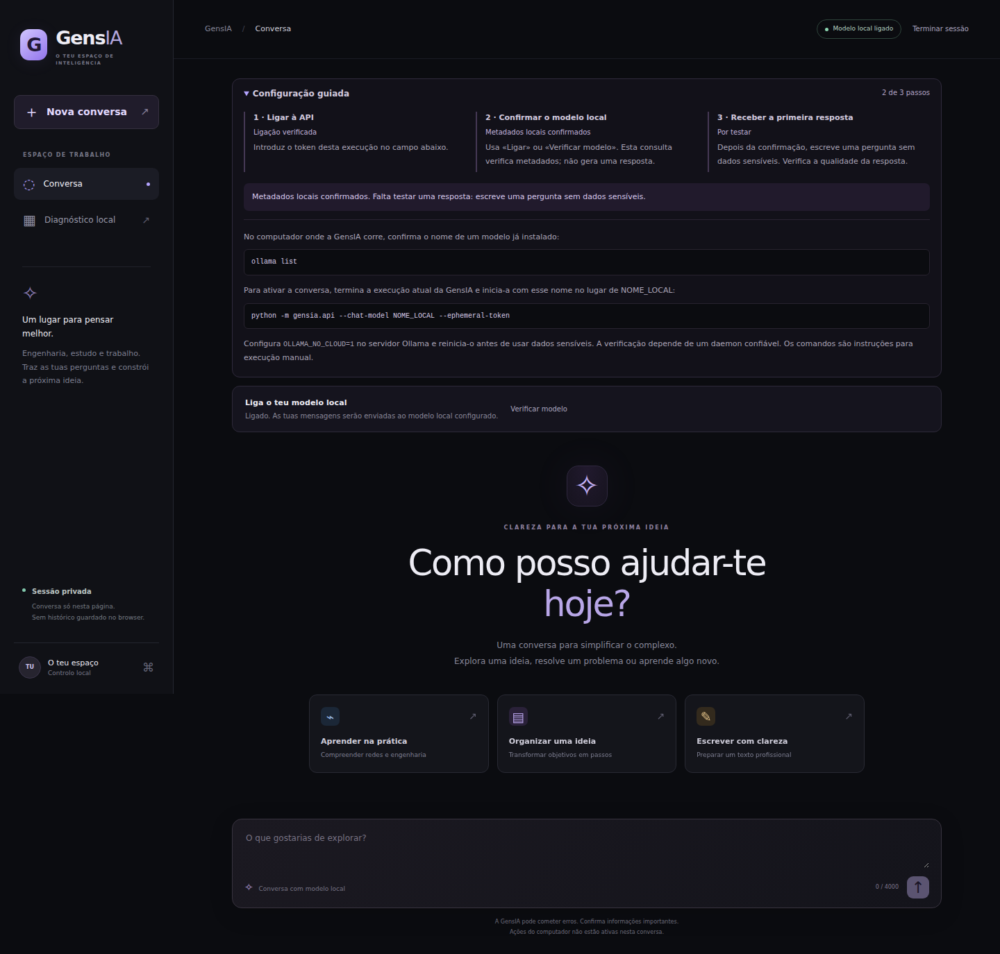
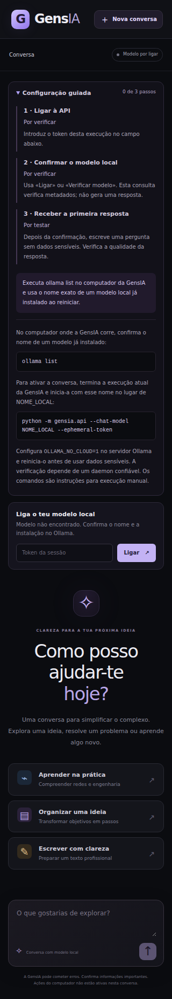

# Evidência visual0.65 — 21/10/2026

Capturas reais de Chromium contra a aplicação FastAPI em execução no CI.
Provider de conversa e metadados sintéticos; erro de modelo ausente injetado
explicitamente pelo teste com page.route/route.fulfill. Não houve inferência
Ollama, acesso a microfone ou operação no computador do utilizador.

- [Run39597871148](https://github.com/Genseric0/GensIA/actions/runs/39597871148): seis jobs PASS.
- Commit: af3a74556888c41b351030b92337e1cafdcbf4ff.
- Job Chromium:119215268178, dez grupos de verificações PASS.
- Artifact12345345585, chromium-conversation-evidence:1028043 bytes.
- ZIP SHA256:87c5c8a94d8aff4a5cd2d8c83ac036d55c324a0e363c7272609c98dcfdc8f30e.

O ZIP foi descarregado e o hash confirmado. Os oito PNG do manifesto foram
inspecionados: guia inicial1440/390, metadados, conversa1440/768/390/320 e erro320.
Sem corte horizontal observado; isto não substitui auditoria com leitor de ecrã.
Os dois PNG abaixo são cópias byte a byte do artifact, sem geração ou edição.
Os restantes ficam no artifact sujeito à retenção do workflow; validation.json
preserva o resultado completo, identificando explicitamente a simulação.

O primeiro run39597189471 falhou numa asserção do runner dentro de details
fechado. Foi corrigido abrindo o guia antes da leitura de texto visível.
A primeira tentativa permanece registada como falha em TEST_REPORT.md.
